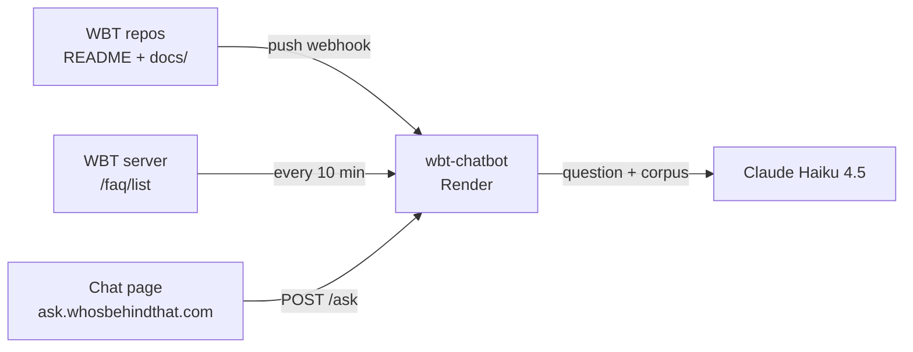

# wbt-chatbot

A Q&A assistant about how [Who's Behind That?](https://whosbehindthat.com) (WBT) was built. It answers questions on WBT's architecture, technical decisions and development history, citing the exact document behind each answer.

## How it works

- **Grounded:** answers come only from WBT's own documentation. That covers the three production repos (README changelog and `docs/`), the three development repos (README changelog), and the live FAQ.
- **Always current:** every push to a WBT repo triggers a GitHub webhook. The service re-fetches that repo at the exact pushed commit and rebuilds the corpus. The FAQ is polled every 10 minutes, and the corpus is rebuilt only when the FAQ changes.
- **No vector database:** the whole corpus (~33k tokens) fits in the prompt, so retrieval can't miss relevant context. Prompt caching keeps repeat questions cheap.
- **Cited:** the model cites source IDs (`[S2]`), and the API returns the matching file titles and GitHub links.
- **Guarded:** per-IP hourly and global daily limits, length limits on questions and history, a CORS allowlist, webhook signature verification, and server-side API keys.
- **Kept awake in working hours:** an external scheduler (cron-job.org) pings the service every 10 minutes, Sunday–Thursday 08:00–21:59 Israel time, so recruiters get instant answers; outside those hours it sleeps on Render's free tier and the page shows a "Waking up" notice during the cold start.

## API

| Method | Path | Purpose |
|---|---|---|
| `POST` | `/ask` | `{ question, history? }` → `{ answer, sources }` |
| `POST` | `/refresh` | GitHub push webhook (HMAC-verified) |
| `GET` | `/health` | Corpus status: per-repo commit, files, FAQ count, approximate tokens |
| `GET` | `/` | Version and status |

## Configuration

| Env var | Required | Default |
|---|---|---|
| `ANTHROPIC_API_KEY` | Yes | — |
| `GITHUB_WEBHOOK_SECRET` | Yes | — |
| `GITHUB_TOKEN` | Recommended | — (read-only, public repos; raises the GitHub API rate limit) |
| `CLAUDE_MODEL` | No | `claude-haiku-4-5` |
| `WBT_SERVER_URL` | No | `https://whos-behind-that-server.onrender.com` |
| `ALLOWED_ORIGINS` | No | `https://ask.whosbehindthat.com,https://haimglikman.github.io,http://localhost:8080` |
| `PER_IP_HOURLY_LIMIT` | No | `20` |
| `GLOBAL_DAILY_LIMIT` | No | `300` |

| `CHATBOT_LOG_KEY` | Recommended | — (same value as on the WBT server; enables the question log) |

## Changelog

### v1.2.3 (chatbot) | Server: v2.7.0 | Admin: v2.30.0 | Client: v1.20.0
- Warm-up checks use the new GET /ready endpoint — some browser privacy filters block URLs containing "health", which left the "Waking up" notice stuck; /health remains for monitoring
- If the warm-up check is blocked (three instant failures), the notice hides instead of persisting; questions still work
- Intro: removed the "designed and built" sentence; each sentence on a single line on desktop (13px, content width 860px)
- package.json: version 1.2.3

### v1.2.2 (chatbot) | Server: v2.7.0 | Admin: v2.30.0 | Client: v1.20.0
- Cold start: the service reports ready once the repo docs are loaded; the FAQ joins when the WBT server responds (readiness no longer waits for it)
- Warm-up checks time out after 10s and retry for up to 3 minutes, so a stalled request can't leave the "Waking up" notice stuck; a successful answer also clears it
- Title uses the full name ("Ask how Who's Behind That? was built"); intro shows one sentence per line within the chat box width
- Footer notes that questions and answers are stored anonymously for monitoring purposes
- package.json: version 1.2.2

### v1.2.1 (chatbot) | Server: v2.7.0 | Admin: v2.30.0 | Client: v1.20.0
- Version shown in the top bar of both pages is now hardcoded and visible on mobile (no longer depends on reaching the service)
- Answers fall back to plain text if the markdown libraries fail to load
- A display failure no longer shows as "Couldn't reach the assistant"
- package.json: version 1.2.1

### v1.2.0 (chatbot) | Server: v2.7.0 | Admin: v2.30.0 | Client: v1.20.0
- Question log: each exchange (question, answer, sources, status, session, tokens, latency) is sent to the WBT server for the admin Chatbot tab; new CHATBOT_LOG_KEY env var
- Answers: shorter and strictly factual (no headings, no dramatic language, no details beyond the sources); grouped citations such as [S1, S6] are now recognized
- Page renders full markdown (headings, italics, lists) via bundled marked and DOMPurify; all citation formats are stripped in favor of source chips
- Live chatbot version shown in the top bar, read from the running service
- New Architecture page (architecture.html) rendering ARCHITECTURE.md live from the server repo, with the system diagram; replaces the link to GitHub
- package.json: version 1.2.0

### v1.1.0 (chatbot) | Server: v2.6.0 | Admin: v2.29.0 | Client: v1.20.0
- Chat page (index.html) for ask.whosbehindthat.com via GitHub Pages: WBT styling, technical starter questions, cited source chips linking to GitHub, warm-up state for cold starts, mobile layout
- Answers focus on technical architecture: production changelogs are the primary source (ordered first, versions cited), docs explain design and reasoning, FAQ used only for product-level questions
- The assistant's own repo (wbt-chatbot) added to the corpus
- package.json: version 1.1.0

### v1.0.0 (chatbot) | Server: v2.3.0 | Admin: v2.26.0 | Client: v1.20.0
- Initial release: `/ask`, `/refresh` (GitHub push webhook), `/health`
- Corpus from the six WBT repos (prod: README + `docs/`; dev: README) and the live FAQ
- Per-repo rebuild on push at the exact pushed commit; FAQ polled every 10 minutes, with a rebuild only on change
- Claude Haiku 4.5 with prompt caching on the corpus; source citations mapped to GitHub links
- Rate limits (20 questions per hour per IP, 300 per day overall), input limits, CORS allowlist
