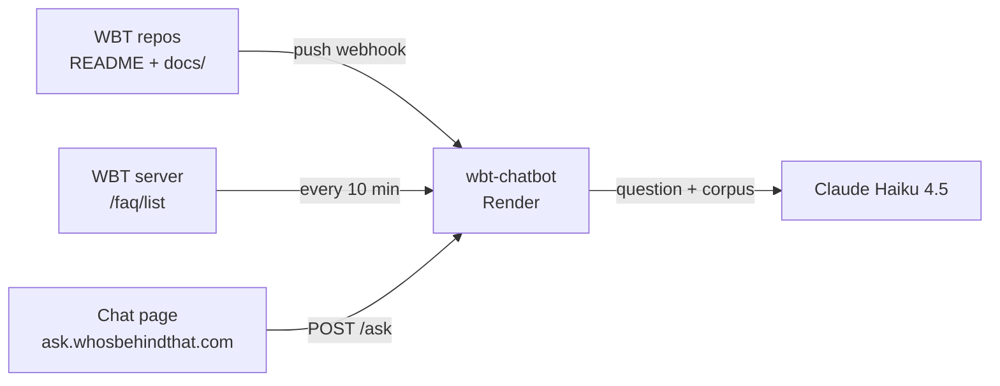

# wbt-chatbot

A Q&A assistant about how [Who's Behind That?](https://whosbehindthat.com) (WBT) was built. It answers questions on WBT's architecture, technical decisions and development history, citing the exact document behind each answer.

## How it works

- **Grounded:** answers come only from WBT's own documentation. That covers the three production repos (README changelog and `docs/`), the three development repos (README changelog), and the live FAQ.
- **Always current:** every push to a WBT repo triggers a GitHub webhook. The service re-fetches that repo at the exact pushed commit and rebuilds the corpus. The FAQ is polled every 10 minutes, and the corpus is rebuilt only when the FAQ changes.
- **No vector database:** the whole corpus (~33k tokens) fits in the prompt, so retrieval can't miss relevant context. Prompt caching keeps repeat questions cheap.
- **Cited:** the model cites source IDs (`[S2]`), and the API returns the matching file titles and GitHub links.
- **Guarded:** per-IP hourly and global daily limits, length limits on questions and history, a CORS allowlist, webhook signature verification, and server-side API keys.

## API

| Method | Path | Purpose |
|---|---|---|
| `POST` | `/ask` | `{ question, history? }` → `{ answer, sources }` |
| `POST` | `/refresh` | GitHub push webhook (HMAC-verified) |
| `GET` | `/health` | Corpus status: per-repo commit, files, FAQ count, approximate tokens |
| `GET` | `/` | Version and status |

## Configuration

| Env var | Required | Default |
|---|---|---|
| `ANTHROPIC_API_KEY` | Yes | — |
| `GITHUB_WEBHOOK_SECRET` | Yes | — |
| `GITHUB_TOKEN` | Recommended | — (read-only, public repos; raises the GitHub API rate limit) |
| `CLAUDE_MODEL` | No | `claude-haiku-4-5` |
| `WBT_SERVER_URL` | No | `https://whos-behind-that-server.onrender.com` |
| `ALLOWED_ORIGINS` | No | `https://ask.whosbehindthat.com,https://haimglikman.github.io,http://localhost:8080` |
| `PER_IP_HOURLY_LIMIT` | No | `20` |
| `GLOBAL_DAILY_LIMIT` | No | `300` |

## Changelog

### v1.0.0 (chatbot) | Server: v2.3.0 | Admin: v2.26.0 | Client: v1.20.0
- Initial release: `/ask`, `/refresh` (GitHub push webhook), `/health`
- Corpus from the six WBT repos (prod: README + `docs/`; dev: README) and the live FAQ
- Per-repo rebuild on push at the exact pushed commit; FAQ polled every 10 minutes, with a rebuild only on change
- Claude Haiku 4.5 with prompt caching on the corpus; source citations mapped to GitHub links
- Rate limits (20 questions per hour per IP, 300 per day overall), input limits, CORS allowlist
